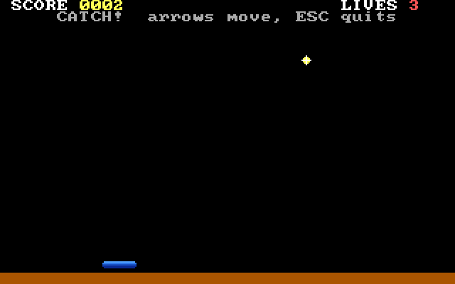

# PakuPort

**Run MS-DOS games as .NET programs, and rebuild them function by function with a judge that
says yes or no.**

PakuPort takes a DOS executable (`.EXE` or `.COM`, real mode or 32-bit protected mode) and turns
it into a .NET project that runs the game: an x86 interpreter executes the original bytes on top
of an emulated PC — DOS, BIOS, VGA/EGA/CGA, keyboard, mouse, timer, PC speaker, Sound Blaster and
OPL2. That is the **port**.

Then it helps you replace the original, piece by piece, with code and art of your own. That is
the **remake**. For every function of the game it writes a folder with the original disassembly
and everything it *measured* while watching the game run: calling convention, globals touched,
what layer it belongs to (drawing, sound, input or logic), how much of it actually ran. You write
the function in C#; a judge replays real recorded calls and compares registers, flags and memory
byte by byte. Green or red, no eyeballing. Your translation can then be plugged into the running
game while everything you have not translated yet keeps running from the original binary.

It works with or without an AI. The folders are written so that a person can read them, and so
that a language model can work on them blind and still be checked by the judge instead of
trusted.



*CATCH, the tiny original DOS game bundled in [`samples/catch`](samples/catch), running as a
.NET program after `pakuport port`.*

## What it does well

- **It runs what the CPU would run, not what a disassembler guesses.** In DOS software, telling
  code from data is undecidable: jump tables, self-modifying code, overlays, packed executables,
  copy protections that decrypt themselves at run time. PakuPort does not try to guess. It
  interprets the original bytes, so all of that simply runs.
- **16-bit and 32-bit games.** Real mode, 16-bit protected mode, 32-bit flat mode with DOS/4GW
  and other extenders (including the ones embedded in the game), paging, VESA, and games that
  jump back and forth between 16- and 32-bit code.
- **It writes down what it saw, not what it supposes.** Because the game runs under its control,
  PakuPort can record every call to every function with what went in and what came out, which
  code actually ran, who drew each pixel and who played each sound. A disassembler can only
  offer guesses; this is a log of what happened.
- **A judge, not an opinion.** Your C# version of a function is replayed against real recorded
  calls and compared with the original byte by byte: registers, flags, memory and even the
  number of instructions. Green or red. If even the original binary cannot reproduce a case, the
  judge says *unjudgeable* instead of blaming you.
- **One piece at a time, with the game running.** A translated function plugs into the running
  game; everything you have not translated yet keeps running from the original binary. You
  never need the whole remake working before you can play it, and an A/B control proves that
  memory and screen stay identical byte for byte.
- **Repeatable to the byte.** The game's clock is the instruction counter. With the same input
  tape and the same cut, two runs leave zero bytes of difference, so a change in behaviour is
  always your change.
- **Made for AI, without trusting the AI.** Each function is a self-contained folder with
  measured facts and one file to write. A model gets facts instead of guesses, and the judge
  decides whether its answer is right. The same folders work for a person with no AI at all.
- **HD art by identity.** Each sprite is identified at the moment the game draws it, not by
  matching pixels on the screen afterwards. The kit writes the brief for every asset, rejects
  deliveries that would break the game and swaps the art in while the game runs, without
  touching the game's memory.
- **A platform checked against a reference.** Small synthetic DOS programs compare PakuPort with
  DOSBox-X subsystem by subsystem, and every check in the project has been seen failing on
  purpose before it is trusted.
- **A double-click `.exe` at the end.** The port is a normal .NET program; `port` can also
  package it as a self-contained executable to play.

Measured on one of the author's test games, an early-1980s commercial arcade game: it has been
rebuilt entirely in C# with the board and the judge, 61 pieces. A full recorded session of 398
million instructions (title, menu, every phase, game over and high scores) runs without the
interpreter executing a single instruction of the original, and memory and screen come out
byte-identical to the original's.

## What is in the box

| | |
|---|---|
| **Port** | `pakuport port GAME.EXE` → a .NET project in `export/<id>/` that plays the game, and optionally a double-click `.exe` |
| **Platform** | DOS (files, memory, EXEC, TSRs), BIOS, VGA/EGA/CGA/text modes, Mode X, VESA, PIT/PIC/DMA, keyboard, mouse, joystick, PC speaker, Sound Blaster (incl. 16-bit DMA), OPL2, MPU-401; DPMI/VCPI hosts for DOS/4GW, DOS/16M and embedded extenders, paging |
| **Measuring tools** | dozens of `PAKU_*` switches that log who draws what, who plays which sound, which code ran, every DOS call, every input; a deterministic input tape |
| **The remake board** | `pakuport expediente tablero`: one folder per function with its measured facts, its disassembly and a C# skeleton |
| **The judge** | `pakuport banco juzga`: replays recorded calls against your C#; checks registers, flags, memory and even the instruction count ("rhythm") |
| **Ask the original** | `pakuport oracle-run`: run one original function with any input you choose |
| **Plug it in** | `pakuport export --portadas`: your translations run inside the game; an A/B control proves nothing changed |
| **HD art kit** | `pakuport remake`: captures every sprite with its identity, writes the art brief, validates what you deliver and swaps it in at runtime |
| **Platform probes** | small synthetic DOS programs in `tools/` that compare PakuPort against DOSBox-X, one subsystem at a time |

## Quick start

**Just want to see a ported game?** Download
[`JugarCatch-win-x64.zip`](https://github.com/unmateria/PakuPort/releases/latest/download/JugarCatch-win-x64.zip), unzip it and
double-click `JugarCatch.exe`: the bundled sample game, ported by PakuPort, with nothing to
install.

**To port and remake games** you need Windows, the [.NET 10 SDK](https://dotnet.microsoft.com/download)
and Python 3.10+. Either download [`PakuPort-win-x64.zip`](https://github.com/unmateria/PakuPort/releases/latest/download/PakuPort-win-x64.zip)
(the repository with the command line already built in `bin\`), or clone and build it:

```powershell
git clone https://github.com/unmateria/PakuPort pakuport
cd pakuport
dotnet build PakuPort.slnx -c Release
python tools\selftest.py
```

`selftest.py` runs the whole chain on the bundled sample and must end with `SELFTEST: GREEN`.
Then port the sample yourself. `pakuport.cmd`, in the repository root, runs the command line
(the prebuilt one in `bin\` if it is there, otherwise `dotnet run` on `src\`):

```powershell
.\pakuport port samples\catch\dos\CATCH.COM --no-package
cd export\catch
dotnet run -c Release
```

The [tutorial](docs/TUTORIAL.md) takes it from there, step by step, all the way to translated
functions running inside the game.

## Documentation

| Read this | to |
|---|---|
| [docs/GETTING-STARTED.md](docs/GETTING-STARTED.md) | install, build, verify, port your first program, the keys of a ported game |
| [docs/TUTORIAL.md](docs/TUTORIAL.md) | the full walkthrough on the sample game: port → measure → board → translate → judge → plug in → HD art |
| [docs/HOW-IT-WORKS.md](docs/HOW-IT-WORKS.md) | the architecture, and *why* it is built this way |
| [docs/REMAKE-WITH-AI.md](docs/REMAKE-WITH-AI.md) | how to hand the board to a language model safely |
| [docs/REMAKE-BY-HAND.md](docs/REMAKE-BY-HAND.md) | the same work without any AI |
| [docs/HD-ART.md](docs/HD-ART.md) | the art kit: capture, brief, deliver, validate, judge |
| [docs/CLI.md](docs/CLI.md) | every command |
| [docs/PROBES.md](docs/PROBES.md) | the platform probes and the DOSBox-X oracle |
| [docs/LIMITATIONS.md](docs/LIMITATIONS.md) | what does not work, said plainly |
| [CONTRIBUTING.md](CONTRIBUTING.md) | rules of the house |
| [README.es.md](README.es.md) | este README, en español |

## Status

PakuPort was developed against about two dozen commercial DOS games, from 1980s real-mode
`.COM` programs to 32-bit DOS/4GW titles. Most of them play end to end; the ones that don't are
listed with their diagnosis in the author's notes, not here, because **this repository ships no
games and names none**. Bring your own, legally obtained copies.

It is a research-grade tool: powerful, measured, and opinionated, but not polished. Parts of the
source comments and of the command-line output are in Spanish. Read
[docs/LIMITATIONS.md](docs/LIMITATIONS.md) before you start.

## License

GPL-3.0-or-later. Parts of the platform layer are derived from DOSBox-X (GPL-2.0-or-later) and
are marked in the code with the file and line they come from; the xBRZ scaler is GPL-3.0. See
[NOTICE.md](NOTICE.md) and [LICENSES/THIRD-PARTY.txt](LICENSES/THIRD-PARTY.txt).

PakuPort does not include, and must not be used to distribute, copyrighted games. The ports it
produces contain the original game's code and data and are for your own use with copies you own.
